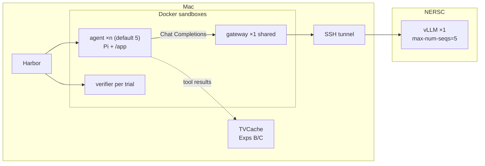

# CS5470 SYSML — Team 39: Parallel Tool-Value Cache

Evaluate DeepSWE agents with Harbor + Pi against vLLM, then add TVCache (sequential → parallel-aware) on the tool-execute path.

## System diagram

**Agent** = **Pi** (tool-calling harness inside the agent sandbox; can emit several tool calls in one turn) **+** the LLM on NERSC (`Qwen/Qwen3.5-9B` over **OpenAI Chat Completions**).

**Harbor** (Mac host process) builds/starts the Docker sandboxes below and feeds each trial `instruction.md`. The SSH tunnel is also a Mac host process. **TVCache** (`tvcache-rust` + `tvclient` on the Mac) caches tool results by trajectory prefix; Experiment A leaves it off (`none`).

Defaults: **pass@k = Harbor concurrency = vLLM `max-num-seqs` = 5**, so five rollouts of one task share one gateway and one vLLM (continuous batching). Monitor NERSC GPU memory; on OOM lower `SYSML_HARBOR_N` / `SYSML_MAX_NUM_SEQS` or use a 4B model. `gpu_memory_utilization` defaults to **0.80** to leave KV headroom for those five sequences.

| Sandbox | Image | How many live at once |
| --- | --- | --- |
| Model gateway | `sysml-model-gateway:refactor-check` (built once) | **1** per live NERSC serve / wave (shared) |
| Agent | task `environment/Dockerfile` (Pi runs **inside** here) | **× `SYSML_HARBOR_N`** (default **5**) |
| Verifier | task `tests/Dockerfile` | **per finished trial** (same image; new container each time) |
| — | NERSC vLLM (not a Mac sandbox) | **1** serve; up to **`SYSML_MAX_NUM_SEQS`** (default **5**) sequences |

Task **count** (3 vs 10) changes how many Harbor jobs you schedule over time; gateway/vLLM stay one shared pair. Concurrent rollouts + one TVCache server (Exps B/C) is the cross-rollout reuse setting.



## How a run works (`bash scripts/run_experiment.sh none`)

```text
run_experiment.sh none
  └─ run_harbor_wave.sh
       ├─ serve_up()     → NERSC: 1× GPU + vLLM (max-num-seqs=5)
       ├─ bridge_up()    → Mac: SSH tunnel + Chat Completions gateway container
       └─ run_task() × each needed task
            └─ harbor run -p variants/.../<task> -k 5 -n 5
                 ├─ agent image  (environment/Dockerfile) — Pi + LoopbackPi inside
                 └─ verifier image (tests/Dockerfile) — after each trial
```

| Step | Code | What it does |
| --- | --- | --- |
| Mode | `scripts/run_experiment.sh` | `none` → wave; `sequential` / `parallel` stub until TVCache is wired |
| Serve | `serve_up()` in `scripts/run_harbor_wave.sh` → `scripts/nersc_serve_model.sbatch` | `salloc --gpus-per-node=1 --constraint=gpu`, then `vllm serve` |
| Bridge | `bridge_up()` in `scripts/run_harbor_wave.sh` | SSH forward + `sysml-model-gateway` (OpenAI Chat Completions proxy: `model.sock` → tunnel → vLLM) |
| Harbor | `run_task()` → `harbor run … -a …LoopbackPi` | Builds agent/verifier containers from the task folder; spawns up to **n** Pi agents |
| Pi | `parallel_tvcache/evaluation/loopback_pi.py` | Official Harbor Pi + in-sandbox model relay; tools stay in the agent container |
| TVCache | — | **Not started** for `none`. Exp B/C will share one Mac-side `tvcache-rust` across the concurrent rollouts |

**Why 1 GPU for 5 concurrent agents?** Five rollouts are five Chat Completions clients to the **same** model. vLLM **continuous-batches** them on one GPU (`--max-num-seqs 5`). Extra GPUs would mean tensor-parallel (split one model) or a second replica + load balancer—neither is required for 9B at seqs=5, and both cost more m4999 hours. If KV OOMs, lower seqs/n or use 4B before adding GPUs.

**`bridge_up` in one line:** yes — it is our Mac-side Chat Completions gateway (plus the SSH tunnel). Agents never talk to NERSC directly; they hit the Unix socket → gateway → tunnel → vLLM `/v1/chat/completions`.

Key files in order: `run_experiment.sh` → `run_harbor_wave.sh` → `nersc_serve_model.sbatch` → `loopback_pi.py` → `inference/model_transport.py` → `variants/deep-swe-setup/tasks/<id>/`.

## Layout

```text
README.md                 teammate entrypoint
docs/
  project_assignment.pdf
  workload_characterization_report.md   Exp A write-up (10×pass@5 cell)
parallel_tvcache/         Harbor/Pi adapters, model transport, measurement, cache prototype
variants/                 Harbor task dirs (instruction + thin image); see below
configs/                  example.env · experiment-tasks.txt · model-gateway.Dockerfile · models/
scripts/
  setup_repositories.sh       clone vendor deps
  prepare_task.py             rebuild a task variant under variants/
  run_experiment.sh           only runner you need: mode = none|sequential|parallel|all
  run_harbor_wave.sh          NERSC + Harbor pass@k with n=k=seqs (default 5)
  nersc_serve_model.sbatch    vLLM on NERSC (reads SYSML_MAX_NUM_SEQS, etc.)
  monitor_nersc_gpu.sh        poll nvidia-smi on the live alloc (GPU memory)
  download_qwen3_5_9b.py      optional: pull weights onto NERSC
  analyze_characterization_wave.sh   parallel-turn fraction for a job prefix
  check_trial.py              post-trial check used by the wave
  run_one.sh                  optional local smoke only (k=1 n=1; not the experiment path)
  demo_cache.py               unwired in-memory cache demo
vendor/                   deep-swe, tvcache-rust, tvclient (gitignored)
jobs/, results/           local run evidence (gitignored)
```

### What a Harbor task is

A DeepSWE task is a folder Harbor loads, mainly:

| Path | Role |
| --- | --- |
| `instruction.md` | User message Pi shows the model |
| `environment/Dockerfile` | Builds the agent sandbox image |
| `tests/` | Separate verifier image + grader (agent never sees this while solving) |
| `solution/` | Reference fix (not shown to the agent) |

At run time the agent only gets **`instruction.md` + a live container**. Harbor builds that container from the Dockerfile; it does not paste the Dockerfile, tests, or solution into the chat.

**Stock DeepSWE:** the Dockerfile already clones and installs, so `/app` is ready when the agent starts and setup never shows up as tool calls.

**Our variants** (`variants/deep-swe-setup/tasks/<id>/`): copy the official task, keep `tests/` the same, then (1) clear `/app` in the agent image and (2) prepend clone/install steps to `instruction.md`. Build more with `scripts/prepare_task.py <task_id> --setup-as-agent-actions`.

## Install

Shared by every experiment:

```bash
uv venv && source .venv/bin/activate          # create + enter Python venv
uv pip install -e '.[dev]'                    # install this package + test deps
uv tool install harbor                        # install Harbor CLI
bash scripts/setup_repositories.sh            # clone vendor/deep-swe, tvcache-rust, tvclient
cp configs/example.env .env                   # local MODEL knobs (gitignored)
python -m pytest -q                           # sanity-check unit tests

# Open the Docker Desktop app, then build the Mac-side model gateway once:
docker build -f configs/model-gateway.Dockerfile -t sysml-model-gateway:refactor-check .
```

## Project status — 2026-11-01

| Experiment | Mode flag | What we measure | Status |
| --- | --- | --- | --- |
| **A** | `none` | Parallel-turn fraction (turns with >1 tool call / all assistant turns) | **Done** — see primary cell below + `docs/workload_characterization_report.md` |
| **B** | `sequential` | Sequential TVCache hit rate / tool-wait (shared TCG across concurrent pass@k) | Not wired yet |
| **C** | `parallel` | Parallel-aware TVCache (within-turn N>1) | Not wired yet |

One runner; pick the mode you want (A-only, B-only, C-only, or `all`). It does **not** re-run other modes unless you pass `all`.

```bash
bash scripts/run_experiment.sh none         # Experiment A only
bash scripts/run_experiment.sh sequential   # Experiment B only (stub today)
bash scripts/run_experiment.sh parallel     # Experiment C only (stub today)
bash scripts/run_experiment.sh all          # A, then B, then C
```

### Experiment A — primary completed cell (2026-11-01)

| Item | Value |
| --- | --- |
| Tasks | **10** setup variants (`configs/experiment-tasks.txt` → `variants/deep-swe-setup/tasks/`) |
| Model / harness | `Qwen/Qwen3.5-9B` · Harbor Pi 1.4 · `LoopbackPi` |
| Budget | `max_turns=8`, thinking off, mode `none`, pass@5 |
| Concurrency | Harbor **`-k 5 -n 5`**, vLLM **`--max-num-seqs 5`**, `gpu_memory_utilization=0.80` |
| Job prefix | `char-setup-10t-k5` |
| GPU | A100-80GB · steady ~65 GiB used · **no OOM** at seqs=5 |
| Result | **0 / 199 = 0.00%** parallel · **50/50** sessions · reward **0** all trials · bash-dominated sequential turns |
| Write-up | `docs/workload_characterization_report.md` (**cell A0** baseline; next: longer context / turns as A1) |
| Artifacts | `results/characterization/char-setup-10t-k5/` · `jobs/char-setup-10t-k5-*/` |

### Experiment A — historical 3-task cell (2026-10-30)

Earlier baseline **before** concurrent defaults: prefix `char-setup-9b-t8v2`, 3 tasks, Harbor `-n 1` / `max-num-seqs 1`, **0 / 55 = 0.00%** parallel. Same qualitative shape; do not conflate with `char-setup-10t-k5`.

**Runner knobs for re-runs:** `harbor -k 5 -n 5`, vLLM `--max-num-seqs 5`, recycle every `SYSML_TASKS_PER_ALLOC` (default 2) within ≤4h QOS. Host **must** export `OPENAI_BASE_URL=http://127.0.0.1:18081/v1` + `OPENAI_API_KEY=EMPTY` (already set inside `run_harbor_wave.sh`).

## Reproduce experiments

Placeholders are **shell env vars**. Replace angle brackets, `export` them, then run.

| Variable | Set to |
| --- | --- |
| `SYSML_NERSC_USER` | your NERSC username |
| `SYSML_REMOTE_ROOT` | `/pscratch/sd/<letter>/<user>/sysml_parallel_tvcache` |
| `SYSML_SSH_HOST` | usually `perlmutter` |
| `SYSML_SLURM_ACCOUNT` | `m4999` |
| `SYSML_JOB_PREFIX` | unique wave name, e.g. `char-setup-10t-k5-rerun` |
| `SYSML_TUNNEL_LOCAL_PORT` | e.g. `18086` |
| `SYSML_PASS_K` | attempts per task (default **5**) |
| `SYSML_HARBOR_N` | concurrent agent sandboxes (default **5**, usually = k) |
| `SYSML_MAX_NUM_SEQS` | vLLM continuous-batching cap (default **5**, usually = k) |
| `SYSML_GPU_MEMORY_UTILIZATION` | default **0.80** (proven with 9B @ seqs=5 on A100-80GB; ~65 GiB steady) |
| `SYSML_ATTACH_JOB` / `SYSML_ATTACH_NODE` | optional: reuse a live READY serve after a Mac runner death |

`run_harbor_wave.sh` also sets `OPENAI_API_KEY=EMPTY` and `OPENAI_BASE_URL=http://127.0.0.1:18081/v1` for Harbor Pi’s custom endpoint. **Do not omit these** if you wrap `harbor run` yourself — missing base URL → zero sessions.

### 1. Connect to NERSC (MFA)

```bash
sshproxy -u <user> -f    # opens browser (Iris / federated login + authenticator OTP)
ssh perlmutter           # optional check, then exit
```

### 2. Export env + run

```bash
export SYSML_NERSC_USER=<user>
export SYSML_REMOTE_ROOT=/pscratch/sd/<letter>/<user>/sysml_parallel_tvcache
export SYSML_SSH_HOST=perlmutter
export SYSML_SLURM_ACCOUNT=m4999
export SYSML_JOB_PREFIX=char-setup-10t-k5-rerun
export SYSML_TUNNEL_LOCAL_PORT=18086
export SYSML_PASS_K=5
export SYSML_HARBOR_N=5
export SYSML_MAX_NUM_SEQS=5
export SYSML_GPU_MEMORY_UTILIZATION=0.80
export SYSML_TASKS_PER_ALLOC=2    # recycle NERSC serve every 2 tasks
export DOCKER_BUILDKIT=0 COMPOSE_DOCKER_CLI_BUILD=0
# OOM on 9B? lower N/SEQS, or set SYSML_MODEL_ID to a 4B and match MODEL=/gateway.
# Resume a live serve (do not scancel first):
#   export SYSML_ATTACH_JOB=<jobid> SYSML_ATTACH_NODE=<nidXXXXXX>

# Prefer Terminal.app or screen — Cursor-shell nohup can reap Harbor while Slurm keeps running:
screen -dmS char10 bash scripts/run_experiment.sh none
# GPU log is written by the wave: results/characterization/$SYSML_JOB_PREFIX/gpu-monitor.log
```

When finished: `ssh perlmutter scancel -u <user> -n sysml-char-9b`

### 3. Analyze (Experiment A metric)

```bash
bash scripts/analyze_characterization_wave.sh "$SYSML_JOB_PREFIX"
# writes results/characterization/<prefix>/parallel_summary.json
# GPU memory samples: results/characterization/<prefix>/gpu-monitor.log
```

## References

- Handout PDF: `docs/project_assignment.pdf`
- Exp A report: `docs/workload_characterization_report.md`
- https://github.com/abhivijay96/tvcache-rust · https://github.com/abhivijay96/tvclient
- https://github.com/harbor-framework/harbor · https://github.com/earendil-works/pi · https://github.com/datacurve-ai/deep-swe
